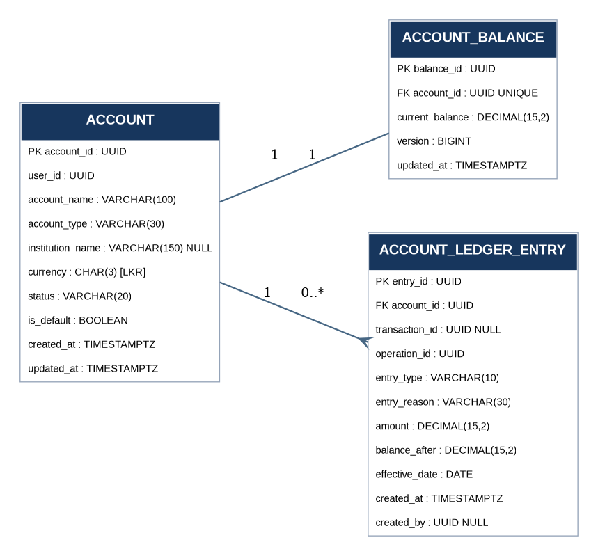

# Account Service – Database Design

**Project:** Personal Finance Management System  
**Service:** Account Service  
**Database:** `account_db`  
**Database Technology:** PostgreSQL  
**ORM:** Spring Data JPA (Hibernate)  
**Database Migration Tool:** Flyway  
**Document Status:** Draft – Under Review  
**Version:** 0.2

---

## 1. Introduction

### 1.1 Purpose

This document describes the database design of the Account Service in the Personal Finance Management System.

The Account Service is responsible for managing users' financial accounts and wallets, maintaining their balances, and preserving account-related financial history.

It provides the foundation for tracking money across different financial locations, such as bank accounts and cash wallets.

### 1.2 Scope

The Account Service is responsible for:

- Creating and managing financial accounts.
- Maintaining account information and account statuses.
- Supporting different account types.
- Maintaining current account balances.
- Recording account balance changes through ledger entries.
- Preserving financial history when an account is deactivated.
- Preventing account balances from becoming negative.
- Providing account and balance information to other services through APIs.

The service will not directly manage expenses, income, budgets, or lending records. Those responsibilities belong to their respective microservices.

### 1.3 Design Objectives

The database design aims to:

- Maintain accurate account balances.
- Preserve a complete history of balance changes.
- Support multiple accounts and wallets per user.
- Prevent accidental loss of financial history.
- Maintain data integrity.
- Prevent duplicate financial operations.
- Support future extensions without major database redesign.

---

## 2. Database Overview

### 2.1 Database Information

| Property | Description |
|---|---|
| Database Name | `account_db` |
| Database System | PostgreSQL |
| ORM | Spring Data JPA (Hibernate) |
| Migration Tool | Flyway |
| Primary Key Strategy | UUID |
| Monetary Data Type | DECIMAL(15,2) |
| Architecture | Microservices |

### 2.2 Database Ownership

The Account Service exclusively owns the `account_db` database.

Other microservices must not directly access or modify its tables. They should retrieve or update account-related information through the Account Service APIs.

Identifiers referencing entities in other services will be stored as external references rather than database foreign keys.

---

## 3. Account Management Overview

The system will support flexible account creation.

When a new user registers, the system will initially provide four default accounts:

1. Bank Savings
2. Bank Daily
3. On-Hand Cash
4. Food Savings

Users will also be able to create additional accounts and wallets according to their requirements.

Users can rename their default accounts and customize their account names.

Each account will have its own account type, status, and balance. Version 1 will support Sri Lankan Rupees (LKR) only.

Accounts can be deactivated without deleting their financial history.

---

## 4. Entity Identification

The Account Service database consists of three main entities.

| Entity | Purpose |
|---|---|
| ACCOUNT | Stores account information. |
| ACCOUNT_BALANCE | Maintains the current balance of each account. |
| ACCOUNT_LEDGER_ENTRY | Records every balance-changing operation. |

### 4.1 ACCOUNT

The ACCOUNT entity stores the basic information about each financial account.

**Proposed Attributes**

| Attribute | Data Type | Constraint | Description |
|---|---|---|---|
| account_id | UUID | Primary Key | Unique account identifier. |
| user_id | UUID | Not Null | Reference to the user in Authentication Service. |
| account_name | VARCHAR(100) | Not Null | Name given to the account. |
| account_type | VARCHAR(30) | Not Null | Classification of the account. |
| institution_name | VARCHAR(150) | Nullable | Bank or financial institution name. |
| currency | CHAR(3) | Not Null, Default 'LKR' | Account currency. Version 1 supports only LKR. |
| status | VARCHAR(20) | Not Null | Current account status. |
| is_default | BOOLEAN | Not Null | Indicates whether the account is a system-provided default account. |
| created_at | TIMESTAMPTZ | Not Null | Account creation timestamp. |
| updated_at | TIMESTAMPTZ | Not Null | Last update timestamp. |

**Possible Account Types**

- BANK
- CASH
- WALLET
- OTHER

**Possible Account Statuses**

- ACTIVE
- INACTIVE

The account name will be customizable. Account types will be used to classify accounts rather than determine their names.

The `is_default` attribute identifies whether an account was initially provided by the system. Renaming a default account will not change this attribute.

The `user_id` attribute references the user managed by the Authentication Service. It will not have a direct foreign key because the user record belongs to another microservice.

### 4.2 ACCOUNT_BALANCE

The ACCOUNT_BALANCE entity maintains the latest balance of each account.

**Proposed Attributes**

| Attribute | Data Type | Constraint | Description |
|---|---|---|---|
| balance_id | UUID | Primary Key | Unique balance record identifier. |
| account_id | UUID | Foreign Key, Unique | Reference to the account. |
| current_balance | DECIMAL(15,2) | Not Null | Latest account balance. |
| version | BIGINT | Not Null, Default 0 | Used for optimistic locking. |
| updated_at | TIMESTAMPTZ | Not Null | Last balance update timestamp. |

Each account will have exactly one current balance record.

The `current_balance` field represents the latest calculated balance. It will be updated whenever a new ledger entry is successfully recorded.

The `version` field will help prevent conflicting balance updates when multiple operations occur simultaneously.

The current balance must never become negative.

### 4.3 ACCOUNT_LEDGER_ENTRY

The ACCOUNT_LEDGER_ENTRY entity stores the history of all balance-changing operations associated with an account.

It provides an auditable record of how the account balance changes over time.

**Proposed Attributes**

| Attribute | Data Type | Constraint | Description |
|---|---|---|---|
| entry_id | UUID | Primary Key | Unique ledger entry identifier. |
| account_id | UUID | Foreign Key, Not Null | Reference to the account. |
| transaction_id | UUID | Nullable | External reference to Transaction Service. |
| operation_id | UUID | Not Null | Identifier used to prevent duplicate processing. |
| entry_type | VARCHAR(10) | Not Null | CREDIT or DEBIT. |
| entry_reason | VARCHAR(30) | Not Null | Purpose of the balance movement. |
| amount | DECIMAL(15,2) | Not Null | Amount recorded in the entry. |
| balance_after | DECIMAL(15,2) | Not Null | Account balance after the entry. |
| effective_date | DATE | Not Null | Date on which the operation takes effect. |
| created_at | TIMESTAMPTZ | Not Null | Date and time the entry was created. |
| created_by | UUID | Nullable | Reference identifying the user or actor responsible for the operation. |

**Entry Types**

- CREDIT – Increases the account balance.
- DEBIT – Decreases the account balance.

A ledger entry will always have a positive amount. The entry type determines whether the amount increases or decreases the balance.

**Entry Reasons**

| Entry Reason | Description |
|---|---|
| OPENING_BALANCE | Initial balance when creating an account. |
| INCOME | Money received. |
| EXPENSE | Money spent. |
| TRANSFER | Money moved between owned accounts. |
| LOAN | Money given to another person as a loan. |
| REPAYMENT | Money received as loan repayment. |
| ADJUSTMENT | Authorized balance correction. |

The `transaction_id` will reference a transaction managed by the Transaction Service. It will not have a direct foreign key.

It can be nullable for entries such as opening balances that do not originate from a normal transaction record.

The `operation_id` will help ensure that the same financial operation is not processed more than once.

The `created_by` attribute identifies the user or actor responsible for initiating the operation. It is an external reference when it identifies a user from the Authentication Service.

Ledger entries will be treated as immutable after posting. Corrections will be recorded using new adjustment entries rather than modifying existing entries.

---

## 5. Entity Relationship Diagram

The Account Service database contains three entities:
ACCOUNT, ACCOUNT_BALANCE, and ACCOUNT_LEDGER_ENTRY.

